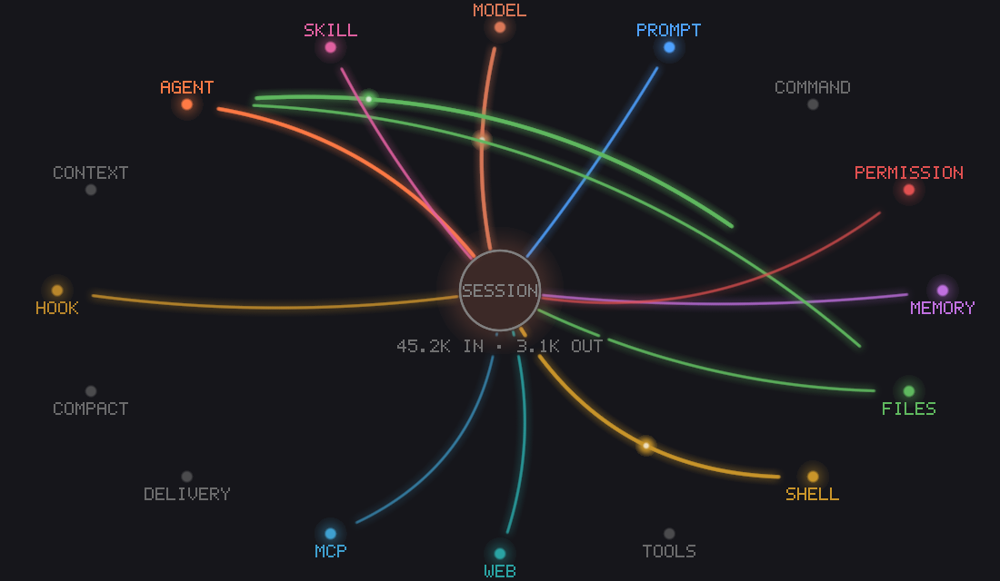

# Claude Mods

Mods for [Claude Code](https://claude.com/claude-code).

A mod is a Claude Code plugin built on its function-hooks API. Instead of adding skills or commands for Claude to use, a mod changes Claude Code itself: a pane beside the chat, a band above the prompt, a status line, or a hook that sees, rewrites or blocks tool calls as they happen. Each mod here lives in its own folder and installs on its own.

## Mods

| | Mod | What it does |
| --- | --- | --- |
|  | [**activity-feed**](./activity-feed) | A live pane that shows everything the agent does as a radial graph: prompts, model requests, tool calls, memory, subagents, skills, MCP, hooks and permission checks, with per-turn token counts. Real pixels in Ghostty, kitty and iTerm2; braille everywhere else. |

[](./activity-feed)

## Install a mod

Every mod installs from the [cc-marketplace](https://github.com/mcfearsome/cc-marketplace). At the prompt of a Claude Code terminal session:

```
/plugin install <mod> --marketplace mcfearsome/cc-marketplace
```

From a shell:

```
claude plugin install <mod> --marketplace mcfearsome/cc-marketplace
```

In the desktop app, where `/plugin` does not run: click **+** next to the prompt box, then **Plugins**, **Add marketplace** with `mcfearsome/cc-marketplace`, then **Add plugin**.

Update later with `claude plugin update <mod>@mcfearsome-cc-marketplace`; remove with `claude plugin uninstall <mod>@mcfearsome-cc-marketplace`.

## Repository layout

```
claude-mods/
├── LICENSE
├── Readme.md
└── <mod>/
    ├── .claude-plugin/
    │   ├── plugin.json      # name, version, description, metadata
    │   └── icon.png         # 1024×1024 listing icon
    ├── hooks/
    │   ├── hooks.json       # names the hooks module
    │   └── *.ts, *.tsx      # the hooks module and what it imports
    ├── types/index.d.ts     # the values the mod keeps in session state
    ├── tests/               # *.test.ts, run by `claude plugin test`
    └── README.md
```

`.claude-plugin/types/` inside a mod is written by Claude Code when it loads the mod, for your editor and `tsc`. It is git-ignored.

## Developing a mod

Run one from its folder, without installing it. Claude Code reloads it when you save:

```
claude --plugin-dir ./activity-feed
```

Check and test it:

```
claude plugin validate activity-feed
claude plugin test activity-feed
```

The API's declarations, with every event, every call on `$` and every element a surface draws, are laid in `<mod>/.claude-plugin/types/claude-code/index.d.ts` once Claude Code has loaded the mod. The API is early access and changes between releases; that file is the reference for the version you run.

To publish a new mod:

1. Add its folder here and push.
2. Add an entry to [cc-marketplace](https://github.com/mcfearsome/cc-marketplace)'s `.claude-plugin/marketplace.json`, with this source:
   ```json
   { "source": "git-subdir", "url": "https://github.com/mcfearsome/claude-mods.git", "path": "<mod>" }
   ```
3. When you release changes, bump `version` in the mod's `plugin.json` and in its marketplace entry.

A mod's name can't start with `claude-`, `anthropic-` or `cc-plugin-`: Claude Code reserves those for its own plugins.

## License

MIT
