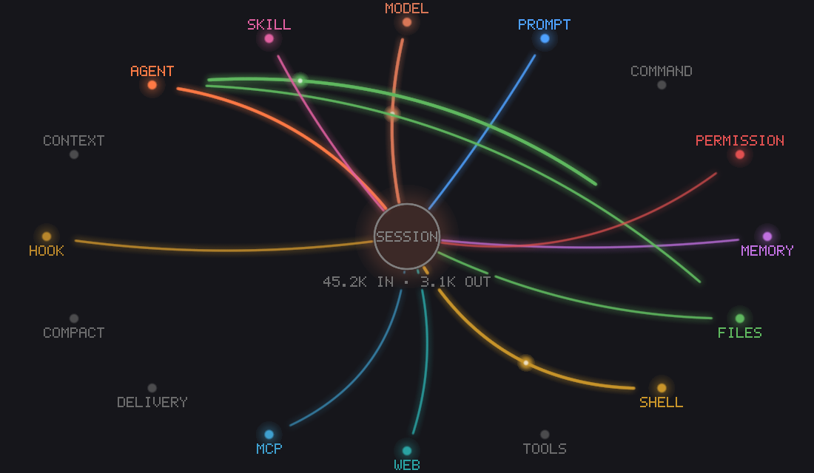

# activity-feed

See what Claude Code is doing while it does it.

activity-feed is a Claude Code mod that opens a live **Activity** pane beside the chat. The session sits in the middle, every place the agent reaches out to sits around it, and each event draws a curved line that lights up while it runs and fades out after. Under the graph is a timed log with token counts.



## Install

At the prompt of a Claude Code terminal session:

```
/plugin install activity-feed --marketplace mcfearsome/cc-marketplace
```

Answer `y` to add the marketplace, then pick a scope. From a shell:

```
claude plugin install activity-feed --marketplace mcfearsome/cc-marketplace
```

In the desktop app: click **+** next to the prompt box, then **Plugins**, **Add marketplace** with `mcfearsome/cc-marketplace`, then **Add plugin**.

The pane opens by itself in interactive sessions when the terminal is wide enough to dock it beside the chat (about 144 columns). At any width, `/activity` opens it.

## Reading the graph

- **The center** is your session. Under it: tokens in and out so far.
- **Each node** is a kind of activity. A node lights up in its color while it has a live edge, and stays grey otherwise.
- **Each edge** is one event. It grows out from the session, stays bright while the event runs (a dot travels along it), then fades over six seconds.
- **Direction** tells you who started it: prompts, slash commands, messages from other sessions and hook-injected context flow *into* the session; everything the agent does flows *out*.
- **Subagents** get their own origin: a subagent's tool calls and model requests start at the **agent** node, not the center, so you can see delegated work separately.

| Node | What lights it |
| --- | --- |
| prompt, command | your prompts and slash commands |
| model | each model request in a turn |
| files | Read, Write, Edit, Glob, Grep |
| shell | Bash and background shells |
| web | WebFetch, WebSearch |
| tools | any other built-in or plugin tool |
| mcp | MCP tool calls (`server:tool` in the log) |
| memory | reads and writes of Claude's memory and `CLAUDE.md` files, and memory Claude Code loads by itself |
| agent | subagents starting and finishing |
| skill | skills loading |
| permission | permission checks that ask you or deny |
| hook, context | context your settings hooks add, and reminders Claude Code injects |
| compact, delivery | context compaction; messages from other sessions and background tasks |

## The log

Under the graph, one line per event, newest last:

```
14:02:11 ✓ [Explore] Grep activity.tsx 41ms
14:02:12 … model claude-opus-5-5 #3
14:02:15 ✓ turn answer 12.3s · in 48.1k (cached 45k) · out 1.2k
```

`…` running, `✓` done, `✗` failed or interrupted, `⊘` denied. Lines from a subagent are tagged with its type. Every finished turn, and every finished subagent, shows its tokens in, cached and out.

The header line totals the session: turns, tokens in and out, cached tokens, and how many events are running right now. The status line shows the tool call in progress.

## Commands

| Command | Does |
| --- | --- |
| `/activity` | Opens the pane |
| `/activity clear` | Empties the log and resets the token totals |
| `/activity pixels` | Draws the graph with real pixels |
| `/activity braille` | Draws the graph with braille characters |
| `/activity auto` | Pixels where the terminal can show images, braille elsewhere (the default) |

## Terminals

| Where | How the graph is drawn |
| --- | --- |
| Ghostty, kitty | Real pixels (kitty graphics protocol): glow, true fades, a transparent background that suits light and dark themes |
| iTerm2 3.5 or later | Real pixels (inline images), in fullscreen rendering |
| tmux | Pixels once `allow-passthrough` and `focus-events` are on (`tmux set -g allow-passthrough on; tmux set -g focus-events on`); the mod tells you when they are off |
| Any other terminal | Braille, animated at 30fps |
| Desktop app, VS Code, mobile | An animated SVG |

If a terminal can't show images, the mod switches to braille by itself. `/activity pixels` tries pixels again.

## What it costs

The mod only watches: it never blocks, rewrites or delays a tool call, prompt or model request, and it writes its log off the critical path. While edges are animating it redraws 15 times a second in pixel mode and 30 in braille, and stops redrawing once everything has faded. The log keeps the last 300 events for the session.

## Develop

From this folder's parent:

```
claude --plugin-dir ./activity-feed     # run it without installing
claude plugin validate activity-feed    # check the manifest and hooks
claude plugin test activity-feed        # run the tests
```

| File | Role |
| --- | --- |
| `hooks/activity.tsx` | The hooks: which events are logged, the pane, the `/activity` command, the animation timer |
| `hooks/graph.ts` | Layout, edge timing, the braille renderer and the SVG renderer |
| `hooks/pixels.ts` | The pixel renderer for kitty graphics and iTerm2 |
| `types/index.d.ts` | The shapes the mod keeps in session state |
| `tests/` | Classification, edge timing, frame sizes, and interrupted calls |

## License

MIT
